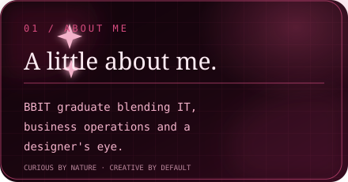
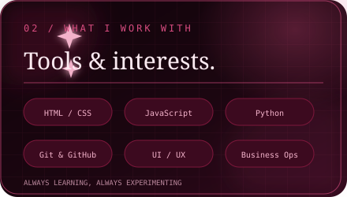
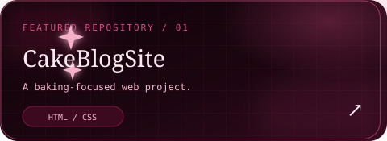
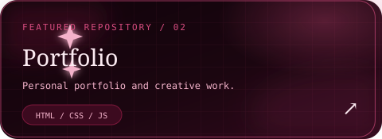

<a href="https://saruet.github.io">PORTFOLIO</a> ·
<a href="https://linkedin.com/in/sarashafqat">LINKEDIN</a> ·
<a href="https://instagram.com/gallerieeme">INSTAGRAM</a>

<table>
<tr>
<td width="44%" valign="top">

</td>
<td width="56%" valign="top">

</td>
</tr>
</table>

## ✦ SELECTED WORK ✦

 

DESIGNED IN BURGUNDY · BUILT WITH CURIOSITY

